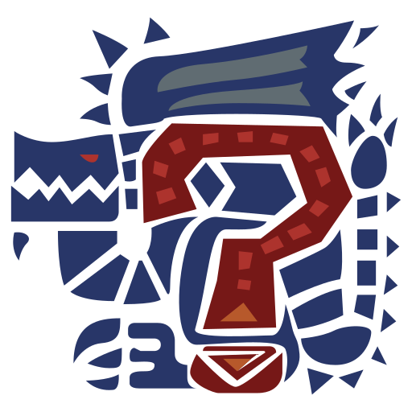

<div align="center">



# Mixed Up Monster Hunter

_A randomizer for Monster Hunter Wilds that rolls monsters and weapons for your hunting party._

[](CHANGELOG.md)
[](https://www.rust-lang.org)
[](https://tauri.app)
[](https://htmx.org)
[](https://tailwindcss.com)

[Overview](#overview) • [Features](#features) • [Getting Started](#getting-started) • [Usage](#usage) • [Development](#development) • [Deployment](#deployment) • [Documentation](#documentation)

</div>

Mixed Up Monster Hunter (_mumh_ for short) is a desktop app for groups of up to
four players who want more variety in their Monster Hunter Wilds hunts: a single
click rolls the next monster along with the hunt objective and a weapon for
every hunter.

## Overview

The app is a [Tauri](https://tauri.app) application that starts an
[axum](https://github.com/tokio-rs/axum) server on a random port on `127.0.0.1`
at launch and displays its UI in the webview window. Pages are rendered
server-side with [Askama](https://github.com/askama-rs/askama) and partially
swapped via [htmx](https://htmx.org) and [Alpine.js](https://alpinejs.dev); the
state (names, player count, last roll, language) is kept in cookies.

The repository consists of the following parts:

- **Application** – Tauri window and axum router, built with [Rust](https://www.rust-lang.org). The code lives in `src/`.
- **Templates** – pages, layouts and htmx components. They live in `templates/`.
- **Game data** – monsters, weapons and translations as JSON. They live in `json/`.
- **Static files** – images, JavaScript and the generated CSS (source: `tailwind.css`). They live in `static/`.

## Features

- **Monster roulette**: rolls one of 39 monsters, including its tier (normal, tempered, arch-tempered) where the monster has one.
- **Hunt objective**: flips a coin between capture and slay for capturable monsters.
- **Weapon roulette**: assigns one of the 14 weapon types to each of 1–4 hunters.
- **Custom hunter names**: names and player count persist between sessions.
- **Bilingual**: UI in English and German, switchable in the footer.
- **Cross-platform**: builds for Linux (AppImage, deb, rpm), macOS (Apple Silicon and Intel) and Windows, plus a Nix flake for NixOS.

## Getting Started

### Prerequisites

- [devenv](https://devenv.sh) (provides Rust, the Tauri CLI, Tailwind CSS and the GTK/WebKit libraries)
- optionally [direnv](https://direnv.net) to load the environment automatically (`.envrc`)

### Development environment

```sh
git clone git@github.com:farbzen/mixedupmh.git
cd mixedupmh
devenv shell
```

> [!TIP]
> Ready-made installers for all platforms are available under
> [Releases](https://github.com/farbzen/mixedupmh/releases) – no development
> environment is needed to play.

### Nix and NixOS

The repository is a Nix flake. Run the app without installing it:

```sh
nix run github:farbzen/mixedupmh
```

> [!TIP]
> To install it on NixOS or with Home Manager, use the flake's overlay – see
> [Nix and NixOS](docs/nix.md).

## Usage

Start the app in development mode:

```sh
cargo tauri dev
```

Regenerate the CSS when templates or `tailwind.css` change (watch mode;
`tailwindmini` produces minified CSS):

```sh
tailwind
```

> [!NOTE]
> In development mode the app reads `static/` and `json/` directly from the
> project directory; only `cargo tauri build` bundles them as resources.
> Changes to the JSON files therefore take effect without a rebuild.

Build installers locally:

```sh
cargo tauri build
```

## Development

### Code quality

Formatting according to `rustfmt.toml` (line width 80) and linting with Clippy:

```sh
cargo fmt
cargo clippy
```

## Deployment

The GitHub workflow `.github/workflows/release.yml` builds releases for Linux,
macOS and Windows with
[tauri-action](https://github.com/tauri-apps/tauri-action) and attaches the
packages to a GitHub release. It runs when a `v*` tag is pushed, or manually:

```sh
git tag v0.5.1
git push origin v0.5.1
```

> [!IMPORTANT]
> The version is stored in `version`, `Cargo.toml` and `tauri.conf.json`; it
> must be bumped in all three files and recorded in
> [CHANGELOG.md](CHANGELOG.md). The release name is derived from the Tauri
> version.

## Documentation

- [Maintaining game data](docs/game-data.md) – adding monsters, weapons and languages
- [Nix and NixOS](docs/nix.md) – flake outputs, installation on NixOS, local builds
- [Changelog](CHANGELOG.md)
